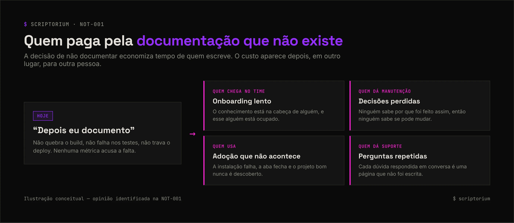

<picture>
  <source media="(prefers-color-scheme: light)" srcset="../_assets/banners/banner-fundamentos-claro.webp">
  
</picture>

# NOT-001 · Por que documentar — e por que a gente sempre deixa pra depois

| Campo | Valor |
|---|---|
| Código | `NOT-001` |
| Tipo | Nota de estudo |
| Status | Publicado |
| Criado em | 15/10/2026 |
| Última atualização | 15/10/2026 · [histórico](https://github.com/SamaraSilvia81/scriptorium/commits/main/01-fundamentos/NOT-001-por-que-documentar.md) |
| Relacionados | [`NOT-002`](NOT-002-diataxis.md) · [`NOT-003`](../02-docs-as-code/NOT-003-o-que-e-docs-as-code.md) · [`GUI-001`](../03-na-pratica/GUI-001-checklist-readme.md) |

> **Pergunta principal:** se todo mundo concorda que documentação importa, por que ela é sempre a primeira coisa a ficar para depois?

## Sumário

1. [A cena](#1-a-cena)
2. [Por que a documentação fica para depois](#2-por-que-a-documentação-fica-para-depois)
3. [Documentação ausente também é dívida técnica](#3-documentação-ausente-também-é-dívida-técnica)
4. [Para quem se escreve](#4-para-quem-se-escreve)
5. [O que vale documentar](#5-o-que-vale-documentar)
6. [O que ajuda na prática](#6-o-que-ajuda-na-prática)
7. [Questões em aberto](#7-questões-em-aberto)
8. [Referências](#8-referências)

## 1. A cena

Você encontra um repositório que parece resolver exatamente o seu problema. O código é bom. O README tem três linhas. O comando de instalação não funciona do jeito descrito, e não há explicação de por que o projeto foi organizado daquele jeito.

Você fecha a aba e procura outra coisa.

O projeto podia ser excelente. Você nunca vai saber. E quem escreveu também não vai saber que perdeu uma pessoa usuária ali.

## 2. Por que a documentação fica para depois

Quase ninguém defende que documentação seja desnecessária. Mesmo assim, ela vive no fim da fila. Três forças explicam boa parte disso:

| Força | Como aparece | Consequência |
|---|---|---|
| **Ela não quebra nada quando falta** | O build passa, os testes passam, o deploy acontece | Não existe alarme. A falta só é percebida quando alguém precisa da informação |
| **O custo cai em outra pessoa** | Quem economiza tempo é quem deixa de escrever; quem paga é quem chega depois | A decisão de não documentar parece racional para quem a toma |
| **Ela mora longe do trabalho** | Wiki separada, ferramenta separada, acesso separado | Atualizar a documentação vira uma tarefa extra, e tarefa extra é a primeira a ser cortada |

A terceira força é a mais fácil de atacar, porque é de processo e não de cultura. É o argumento central de [docs-as-code](../02-docs-as-code/NOT-003-o-que-e-docs-as-code.md) — e o [caso do Pinterest](../04-casos/CAS-001-pinterest-docs-as-code.md) mostra uma empresa que tentou mudar a cultura com eventos e apelos, não conseguiu, e só viu resultado quando mudou a ferramenta.

## 3. Documentação ausente também é dívida técnica

*Esta seção mistura conceito estabelecido e opinião minha. A opinião está identificada.*

**O conceito.** A metáfora de dívida técnica foi proposta por Ward Cunningham em 1992: escolher uma solução mais rápida hoje é como pegar um empréstimo, e o custo extra de trabalhar sobre essa escolha depois são os juros. A pesquisa em engenharia de software ampliou a ideia para além do código, e **dívida de documentação** (*documentation debt*) aparece como um dos tipos catalogados — documentação ausente, incompleta ou desatualizada que cobra juros em entendimento e manutenção.

**A opinião.** O que torna a dívida de documentação especialmente perigosa é que ela é **invisível**. Dívida no código às vezes aparece numa análise estática, num teste lento, num bug. Nenhuma ferramenta vai apontar que a decisão mais importante do sistema nunca foi escrita em lugar nenhum.

<picture>
  <source media="(prefers-color-scheme: light)" srcset="../_assets/diagramas/custo-da-documentacao-ausente-claro.webp">
  
</picture>

Uma curiosidade: parte dessa dívida é **admitida** pelas próprias pessoas desenvolvedoras, em comentários como `TODO: documentar isso` ou `FIXME: explicar por que`. A pesquisa chama isso de *self-admitted technical debt* (SATD) — dívida que quem escreveu sabia que estava deixando.

## 4. Para quem se escreve

Documentação genérica não serve bem a ninguém. Antes de escrever, vale perguntar quem vai ler e em que momento:

| Quem lê | O que precisa | Onde costuma procurar |
|---|---|---|
| Quem vai **usar** | Entender o que é, instalar, ter um primeiro resultado | README, guia de início rápido |
| Quem vai **contribuir** | Saber como rodar localmente, padrões, como abrir PR | `CONTRIBUTING.md`, guias |
| Quem vai **manter** | Entender por que as coisas são como são | Registros de decisão (ADRs), explicações de arquitetura |
| **Você daqui a seis meses** | Lembrar o que estava pensando | Tudo acima — e você vai agradecer |

Essa divisão é a base do [Diátaxis](NOT-002-diataxis.md), que organiza a documentação pela necessidade de quem lê.

## 5. O que vale documentar

Documentar tudo é tão problemático quanto não documentar nada: texto demais esconde o que importa e desatualiza mais rápido.

**Vale documentar:**

- **O que o código não diz.** O código mostra *como*; raramente mostra *por quê*. Decisões, alternativas descartadas e restrições externas só existem se alguém escrever.
- **O caminho mínimo.** Como instalar, como rodar, como ter o primeiro resultado. É o que mais gente lê.
- **O que é caro de redescobrir.** Configuração de ambiente, integrações, armadilhas conhecidas.

**Costuma não valer:**

- Repetir em texto o que um nome de função bem escolhido já diz.
- Descrever detalhes de implementação que mudam toda semana — a doc vai desatualizar antes de alguém ler.

## 6. O que ajuda na prática

Não existe receita única, mas três ideias aparecem em muitos contextos:

1. **Saber o tipo de texto que se está escrevendo.** Tutorial, guia, referência e explicação são coisas diferentes. → [`NOT-002` Diátaxis](NOT-002-diataxis.md)
2. **Deixar a documentação perto do código.** Se ela passa pela mesma revisão, tem mais chance de acompanhar as mudanças. → [`NOT-003` Docs-as-code](../02-docs-as-code/NOT-003-o-que-e-docs-as-code.md)
3. **Começar pelo mínimo útil.** Um README que explica o que é, como rodar e onde pedir ajuda já resolve boa parte do problema. → [`GUI-001` Checklist de README](../03-na-pratica/GUI-001-checklist-readme.md)

## 7. Questões em aberto

- Como medir o custo da documentação ausente de um jeito que convença quem decide prioridade?
- Em projetos open source, a qualidade do README tem relação com a adoção do projeto?
- Quanto da dívida de documentação é admitida (SATD) e quanto passa despercebida?

## 8. Referências

- CUNNINGHAM, Ward. [The WyCash Portfolio Management System](https://c2.com/doc/oopsla92.html). OOPSLA, 1992. — origem da metáfora de dívida técnica.
- ALVES, Nicolli S. R. et al. *Towards an Ontology of Terms on Technical Debt*. MTD, 2014. — catálogo de tipos de dívida técnica, incluindo dívida de documentação.
- POTDAR, Aniket; SHIHAB, Emad. *An Exploratory Study on Self-Admitted Technical Debt*. ICSME, 2014. — origem do termo SATD.
- PROCIDA, Daniele. [Diátaxis](https://diataxis.fr/).
- WRITE THE DOCS. [Docs as Code](https://www.writethedocs.org/guide/docs-as-code/).
- SEILER, Jacob; KIM, Jay; GU, Charlie. [Adopting Docs-as-Code at Pinterest](https://medium.com/pinterest-engineering/adopting-docs-as-code-at-pinterest-4f18ad169c25). Pinterest Engineering, 2025.

<picture>
  <source media="(prefers-color-scheme: light)" srcset="../_assets/banners/banner-rodape-claro.webp">
  
</picture>
