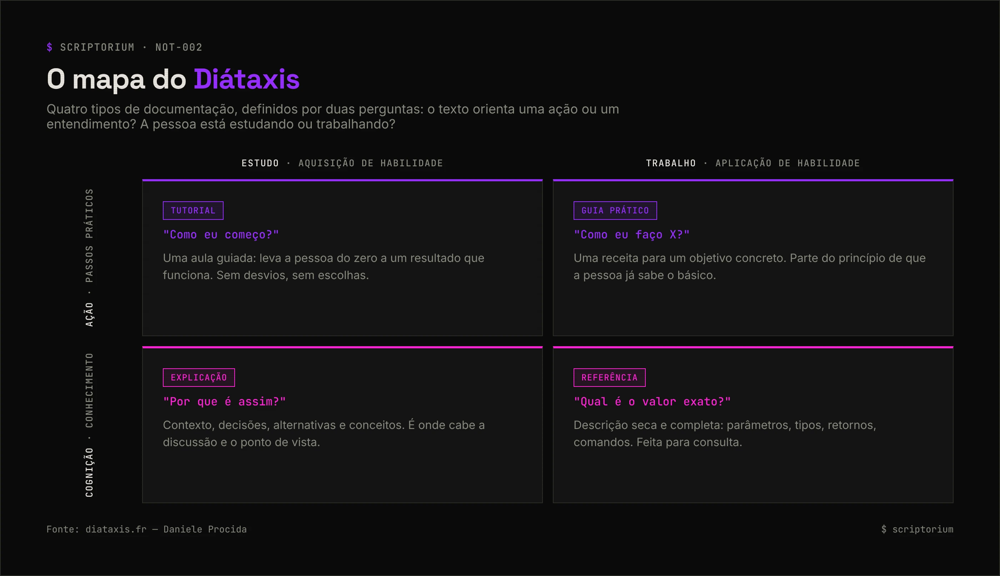

<picture>
  <source media="(prefers-color-scheme: light)" srcset="../_assets/banners/banner-fundamentos-claro.webp">
  
</picture>

# NOT-002 · Diátaxis: os quatro tipos de documentação

| Campo | Valor |
|---|---|
| Código | `NOT-002` |
| Tipo | Nota de estudo |
| Status | Publicado |
| Criado em | 15/10/2026 |
| Última atualização | 15/10/2026 · [histórico](https://github.com/SamaraSilvia81/scriptorium/commits/main/01-fundamentos/NOT-002-diataxis.md) |
| Relacionados | [`NOT-001`](NOT-001-por-que-documentar.md) · [`GUI-001`](../03-na-pratica/GUI-001-checklist-readme.md) |

> **Pergunta principal:** por que tanta documentação parece confusa mesmo quando tem bastante conteúdo?

## Sumário

1. [O problema](#1-o-problema)
2. [O que é o Diátaxis](#2-o-que-é-o-diátaxis)
3. [A bússola: duas perguntas](#3-a-bússola-duas-perguntas)
4. [Os quatro tipos em detalhe](#4-os-quatro-tipos-em-detalhe)
5. [Exemplo: aplicando a um projeto](#5-exemplo-aplicando-a-um-projeto)
6. [Erros comuns](#6-erros-comuns)
7. [Quem usa](#7-quem-usa)
8. [Limitações](#8-limitações)
9. [Referências](#9-referências)

## 1. O problema

Uma página de documentação começa ensinando a instalar, para no meio para explicar a arquitetura, lista quinze parâmetros de configuração e termina com uma seção de "dicas". Tem bastante informação. Mesmo assim, quem quer só instalar se perde na arquitetura, e quem quer só consultar um parâmetro precisa ler a página inteira.

O texto não é ruim. Ele está tentando fazer quatro trabalhos diferentes ao mesmo tempo.

## 2. O que é o Diátaxis

O [Diátaxis](https://diataxis.fr/) é uma abordagem para escrever e organizar documentação técnica, criada por **Daniele Procida**. O nome vem do grego: *dia* (através) e *taxis* (arranjo).

A ideia central: existem **quatro necessidades distintas** de quem lê documentação, e cada uma pede um tipo de texto com conteúdo, estilo e organização próprios. Misturar os tipos faz cada um deles funcionar pior.

## 3. A bússola: duas perguntas

O Diátaxis classifica qualquer trecho de documentação com duas perguntas:

1. **O texto orienta uma ação ou um entendimento?** — ação são passos práticos; entendimento (*cognição*) é conhecimento teórico.
2. **A pessoa está estudando ou trabalhando?** — estudar é *adquirir* uma habilidade; trabalhar é *aplicar* uma habilidade que já tem.

| | Estudo (aquisição) | Trabalho (aplicação) |
|---|---|---|
| **Ação** | Tutorial | Guia prático |
| **Cognição** | Explicação | Referência |

<picture>
  <source media="(prefers-color-scheme: light)" srcset="../_assets/diagramas/diataxis-mapa-claro.webp">
  
</picture>

## 4. Os quatro tipos em detalhe

### Tutorial — "Como eu começo?"

Uma aula guiada. Leva a pessoa iniciante do zero até um resultado concreto que funciona, para que ela ganhe confiança.

| Faça | Evite |
|---|---|
| Um caminho único, do começo ao fim | Oferecer alternativas ("você também pode...") |
| Resultados visíveis a cada passo | Explicar teoria no meio dos passos |
| Garantir que funciona — teste o tutorial | Assumir conhecimento prévio |

### Guia prático (*how-to*) — "Como eu faço X?"

Uma receita para um objetivo específico. A pessoa já sabe o básico e chegou com uma tarefa na mão.

| Faça | Evite |
|---|---|
| Título com o objetivo ("Como configurar autenticação") | Ensinar o básico de novo |
| Passos diretos, na ordem em que são feitos | Explicações longas — link para elas |
| Mencionar variações reais do problema | Tentar cobrir todos os casos possíveis |

### Referência — "Qual é o valor exato?"

Descrição técnica, seca e completa. Feita para consulta rápida, não para leitura corrida.

| Faça | Evite |
|---|---|
| Estrutura consistente (mesma ordem em cada item) | Instruções ou opiniões |
| Cobrir tudo: parâmetros, tipos, padrões, erros | Exemplos longos — exemplos curtos bastam |
| Espelhar a estrutura do próprio produto | Deixar desatualizar: gere a partir do código quando possível |

### Explicação — "Por que é assim?"

Contexto e compreensão. Decisões de design, alternativas consideradas, história, conceitos por trás.

| Faça | Evite |
|---|---|
| Responder "por quê" | Instruções passo a passo |
| Conectar com outros conceitos | Detalhes de referência |
| Admitir pontos de vista e trade-offs | Fingir neutralidade onde houve escolha |

## 5. Exemplo: aplicando a um projeto

Imagine uma biblioteca de formatação de datas com um único `README.md` de 600 linhas. Aplicando o Diátaxis:

| Trecho atual do README | Vira | Onde |
|---|---|---|
| "Primeiros passos" | Tutorial | `docs/tutorial.md` |
| "Como formatar datas em outro fuso" | Guia prático | `docs/guias/fusos-horarios.md` |
| Lista de todas as funções e opções | Referência | `docs/referencia/api.md` (gerada a partir do código) |
| "Por que não usamos `Date` nativo" | Explicação | `docs/explicacoes/por-que-nao-date.md` ou um ADR |

O README encolhe e vira **porta de entrada**: o que é, instalação mínima e links para cada tipo.

Em projetos pequenos, não precisa de quatro arquivos. Basta o README ter seções separadas por tipo — a ideia vale mais que a estrutura de pastas.

## 6. Erros comuns

- **Tutorial que vira explicação.** No meio do passo 3, dois parágrafos sobre a história da arquitetura. Quem está aprendendo perde o fio.
- **Referência que vira tutorial.** A página de API começa com "primeiro, vamos instalar...". Quem só queria o tipo de retorno de uma função precisa rolar.
- **Guia prático que ensina o básico.** "Como configurar cache" que começa explicando o que é cache. Quem chegou com a tarefa já sabe.
- **Explicação espalhada.** O "porquê" aparece em fragmentos pelos outros tipos, e nunca num lugar onde dá para encontrar.

## 7. Quem usa

O site do Diátaxis afirma que a abordagem foi adotada em centenas de projetos e traz depoimentos, entre outros, de equipes de documentação da **Gatsby**, da **Cloudflare** (documentação para pessoas desenvolvedoras) e da **Vonage**.

## 8. Limitações

- Nem todo conteúdo cabe perfeitamente em uma caixa. O framework funciona melhor como **lente para revisar** do que como regra rígida.
- Projetos pequenos podem cair na armadilha de criar estrutura antes de ter conteúdo.
- Reorganizar uma documentação existente pelo Diátaxis é trabalho grande; o próprio site sugere melhorar aos poucos, um trecho de cada vez.

## 9. Referências

- PROCIDA, Daniele. [Diátaxis](https://diataxis.fr/). Site oficial.
- PROCIDA, Daniele. [The compass](https://diataxis.fr/compass/). Diátaxis.

<picture>
  <source media="(prefers-color-scheme: light)" srcset="../_assets/banners/banner-rodape-claro.webp">
  
</picture>
