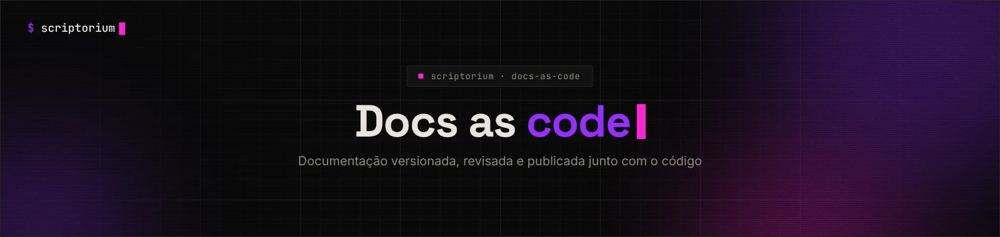
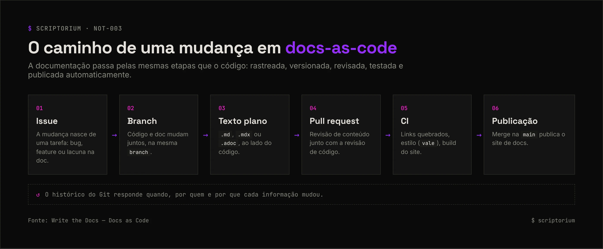

<picture>
  <source media="(prefers-color-scheme: light)" srcset="../_assets/banners/banner-docs-as-code-claro.webp">
  
</picture>

# NOT-003 · O que é docs-as-code

| Campo | Valor |
|---|---|
| Código | `NOT-003` |
| Tipo | Nota de estudo |
| Status | Publicado |
| Criado em | 15/10/2026 |
| Última atualização | 15/10/2026 · [histórico](https://github.com/SamaraSilvia81/scriptorium/commits/main/02-docs-as-code/NOT-003-o-que-e-docs-as-code.md) |
| Relacionados | [`NOT-001`](../01-fundamentos/NOT-001-por-que-documentar.md) · [`CAS-001`](../04-casos/CAS-001-pinterest-docs-as-code.md) |

> **Pergunta principal:** se a documentação desatualiza tão fácil, o que muda quando ela segue o mesmo caminho do código?

## Sumário

1. [A ideia](#1-a-ideia)
2. [As cinco práticas](#2-as-cinco-práticas)
3. [O caminho de uma mudança](#3-o-caminho-de-uma-mudança)
4. [Por que isso funciona](#4-por-que-isso-funciona)
5. [Quem faz assim](#5-quem-faz-assim)
6. [Ferramentas](#6-ferramentas)
7. [Exemplo: verificação automática no GitHub Actions](#7-exemplo-verificação-automática-no-github-actions)
8. [Limitações](#8-limitações)
9. [Como começar pequeno](#9-como-começar-pequeno)
10. [Referências](#10-referências)

## 1. A ideia

*Docs-as-code* é a filosofia de escrever documentação **com as mesmas ferramentas e o mesmo fluxo de trabalho usados para desenvolver software**. A comunidade Write the Docs, que popularizou o termo, acrescenta um ponto que costuma ficar de fora: quem escreve e quem desenvolve **compartilham a responsabilidade** pela documentação e trabalham juntos nela.

Não é uma ferramenta. É uma decisão de processo: a documentação deixa de morar numa wiki separada e passa a viver no repositório, sujeita às mesmas regras que o código.

## 2. As cinco práticas

| Prática | No código | Na documentação |
|---|---|---|
| **Rastreamento de tarefas** | Issues para bugs e features | Issues para lacunas e erros na doc |
| **Controle de versão** | Git | O mesmo Git, de preferência o mesmo repositório |
| **Texto plano** | Código-fonte | Markdown, MDX, reStructuredText ou AsciiDoc |
| **Revisão** | Code review em pull request | Revisão de conteúdo na mesma PR |
| **Testes automatizados** | Testes unitários e lint | Links quebrados, estilo, ortografia, build do site |

## 3. O caminho de uma mudança

<picture>
  <source media="(prefers-color-scheme: light)" srcset="../_assets/diagramas/docs-as-code-fluxo-claro.webp">
  
</picture>

O ponto mais importante do fluxo é o **04**: quando uma PR muda um comportamento, a revisão é o momento natural de perguntar "e a documentação?". Algumas equipes vão além e **bloqueiam o merge** de features sem documentação — assim a doc é escrita enquanto o assunto ainda está fresco.

## 4. Por que isso funciona

- **A documentação muda junto com o código.** A mesma PR que altera um comportamento atualiza o texto, e a revisão pega quando isso não acontece.
- **A barreira de entrada cai.** Quem escreve código já usa Git, editor e PR. Não precisa aprender outra ferramenta nem pedir acesso a outro sistema.
- **Tudo fica rastreável.** O histórico responde quando, por quem e por que cada informação mudou.
- **Pessoas desenvolvedoras escrevem o primeiro rascunho.** Quem tem documentação como função revisa e melhora, em vez de começar do zero.
- **O texto plano é portátil.** Markdown abre em qualquer editor, vira site com qualquer gerador e é fácil de ser lido por ferramentas — inclusive por modelos de IA, como o Pinterest destacou no relato deles.

## 5. Quem faz assim

- **GitHub** — toda a documentação de [docs.github.com](https://docs.github.com) vive num repositório público, [`github/docs`](https://github.com/github/docs), em Markdown, aberto a contribuições por pull request.
- **Pinterest** — migrou a documentação interna de uma wiki para docs-as-code com uma ferramenta própria. → [`CAS-001`](../04-casos/CAS-001-pinterest-docs-as-code.md)
- **Outras organizações** — o guia da Write the Docs reúne palestras sobre adoções no Google, no serviço digital do governo do Reino Unido (GDS), na AWS, entre outras.

## 6. Ferramentas

### Geradores de site

| Ferramenta | Base | Bom para |
|---|---|---|
| [Docusaurus](https://docusaurus.io/) | React | Projetos open source, versões múltiplas da doc |
| [Astro Starlight](https://starlight.astro.build/) | Astro | Sites leves com boa experiência padrão |
| [MkDocs](https://www.mkdocs.org/) + [Material](https://squidfunk.github.io/mkdocs-material/) | Python | Documentação técnica com pouca configuração |
| [VitePress](https://vitepress.dev/) | Vue/Vite | Projetos do ecossistema Vue |

### Qualidade

| Ferramenta | O que verifica |
|---|---|
| [markdownlint](https://github.com/DavidAnson/markdownlint) | Consistência da sintaxe Markdown |
| [Vale](https://vale.sh/) | Estilo e terminologia, com regras configuráveis |
| [lychee](https://github.com/lycheeverse/lychee) | Links quebrados |

## 7. Exemplo: verificação automática no GitHub Actions

Um fluxo mínimo que roda em toda pull request e verifica a formatação do Markdown e os links:

```yaml
# .github/workflows/docs.yml
name: docs

on:
  pull_request:
    paths: ["**/*.md"]

jobs:
  verificar:
    runs-on: ubuntu-latest
    steps:
      - uses: actions/checkout@v7

      - name: Formatação do Markdown
        uses: DavidAnson/markdownlint-cli2-action@v24
        with:
          globs: "**/*.md"

      - name: Links quebrados
        uses: lycheeverse/lychee-action@v2
        with:
          args: --no-progress "**/*.md"
          fail: true
```

Com isso, uma PR que quebra um link ou bagunça a formatação aparece com um ✗ vermelho, igual a um teste que falhou.

## 8. Limitações

- **Melhora o processo, não a escrita.** Uma documentação ruim versionada continua ruim. Docs-as-code precisa vir junto com cuidado de conteúdo (→ [`NOT-002` Diátaxis](../01-fundamentos/NOT-002-diataxis.md)).
- **Pode afastar quem não usa Git.** Produto, suporte e design podem ter mais dificuldade de contribuir. O Pinterest listou um editor visual que gera PRs automaticamente como trabalho futuro justamente por isso.
- **O legado não migra sozinho.** Sem um plano de migração, o conteúdo antigo continua na ferramenta velha e a equipe fica com duas fontes de verdade.
- **Exige combinado de equipe.** "Mudança sem doc não está pronta" só funciona se todo mundo concordar.

## 9. Como começar pequeno

1. Mova a documentação que existe para uma pasta `docs/` no repositório, em Markdown.
2. Adicione ao template de PR a pergunta: "Esta mudança precisa atualizar a documentação?"
3. Configure a verificação de links (seção 7). É o teste com melhor custo-benefício.
4. Só depois pense em gerador de site, estilo automatizado e publicação.

## 10. Referências

- WRITE THE DOCS. [Docs as Code](https://www.writethedocs.org/guide/docs-as-code/).
- GITHUB. [github/docs](https://github.com/github/docs). Repositório da documentação do GitHub.
- SEILER, Jacob; KIM, Jay; GU, Charlie. [Adopting Docs-as-Code at Pinterest](https://medium.com/pinterest-engineering/adopting-docs-as-code-at-pinterest-4f18ad169c25). Pinterest Engineering, 2025.

<picture>
  <source media="(prefers-color-scheme: light)" srcset="../_assets/banners/banner-rodape-claro.webp">
  
</picture>
