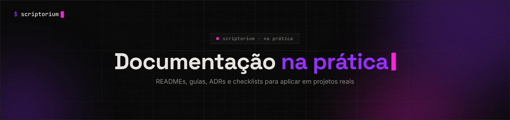

<picture>
  <source media="(prefers-color-scheme: light)" srcset="../_assets/banners/banner-na-pratica-claro.webp">
  
</picture>

# GUI-001 · Checklist de README

| Campo | Valor |
|---|---|
| Código | `GUI-001` |
| Tipo | Guia prático |
| Status | Publicado |
| Criado em | 15/10/2026 |
| Última atualização | 15/10/2026 · [histórico](https://github.com/SamaraSilvia81/scriptorium/commits/main/03-na-pratica/GUI-001-checklist-readme.md) |
| Relacionados | [`NOT-001`](../01-fundamentos/NOT-001-por-que-documentar.md) · [`NOT-002`](../01-fundamentos/NOT-002-diataxis.md) |

> **Objetivo:** revisar o README de um projeto em poucos minutos e saber o que falta. Nem todo item se aplica a todo projeto — use como ponto de partida, não como regra.

## Sumário

1. [Como usar](#1-como-usar)
2. [Nível 1 — o essencial](#2-nível-1--o-essencial)
3. [Nível 2 — projetos que recebem outras pessoas](#3-nível-2--projetos-que-recebem-outras-pessoas)
4. [Nível 3 — projetos maiores](#4-nível-3--projetos-maiores)
5. [Sinais de alerta](#5-sinais-de-alerta)
6. [Teste dos cinco minutos](#6-teste-dos-cinco-minutos)
7. [Esqueleto pronto](#7-esqueleto-pronto)
8. [Referências](#8-referências)

## 1. Como usar

O checklist está dividido em três níveis. Um projeto pessoal precisa do nível 1. Um projeto que aceita contribuições precisa do 1 e do 2. Uma biblioteca ou produto usado por muita gente precisa dos três.

Copie a lista para uma issue do seu projeto e marque conforme revisa.

## 2. Nível 1 — o essencial

Se o README só tiver isso, já resolve boa parte do problema.

| ✓ | Item | Por quê |
|---|---|---|
| ☐ | **O que é**, em uma ou duas frases | Quem chega decide em segundos se continua lendo |
| ☐ | **Para que serve** — problema que resolve ou para quem é | Diferencia o projeto de outros parecidos |
| ☐ | **Pré-requisitos** com versões (Node 22+, Python 3.12+...) | Metade dos "não funciona" é versão errada |
| ☐ | **Como instalar e rodar**, com comandos copiáveis | É a seção mais lida de qualquer README |
| ☐ | **Um exemplo mínimo** que funciona | Mostra o projeto em ação melhor que qualquer descrição |
| ☐ | **Status** — ativo, em construção, arquivado | Evita que alguém dependa de algo abandonado |

## 3. Nível 2 — projetos que recebem outras pessoas

| ✓ | Item | Por quê |
|---|---|---|
| ☐ | **Estrutura de pastas** em poucas linhas | Reduz o tempo até a primeira contribuição |
| ☐ | **Como contribuir**, ou link para `CONTRIBUTING.md` | Define expectativas antes da primeira PR |
| ☐ | **Licença** | Sem licença, legalmente ninguém pode reutilizar o código |
| ☐ | **Onde pedir ajuda** — issues, discussões, contato | Evita perguntas em lugares errados |
| ☐ | **Como rodar os testes** | Quem contribui precisa saber se quebrou algo |

## 4. Nível 3 — projetos maiores

| ✓ | Item | Por quê |
|---|---|---|
| ☐ | **Links para a documentação completa**, separada por tipo | O README vira porta de entrada, não manual inteiro (→ [`NOT-002`](../01-fundamentos/NOT-002-diataxis.md)) |
| ☐ | **Configuração e variáveis de ambiente** | É o que mais trava quem tenta rodar |
| ☐ | **Decisões importantes** ou link para os ADRs | Responde o "por que é assim?" antes de virar issue |
| ☐ | **Changelog** ou link para as releases | Quem atualiza precisa saber o que mudou |
| ☐ | **Compatibilidade** — navegadores, sistemas, versões suportadas | Evita relatos de bug que não são bug |

## 5. Sinais de alerta

- O comando de instalação não funciona numa máquina limpa.
- O README descreve uma versão antiga do projeto.
- Tem badge, logo e emoji, mas não diz o que o projeto faz.
- Tudo está num bloco único, sem títulos.
- O exemplo usa uma função que não existe mais.
- "Documentação em breve" há mais de seis meses.

## 6. Teste dos cinco minutos

Peça para alguém que nunca viu o projeto:

1. Ler o README por um minuto e dizer, com as próprias palavras, o que o projeto faz.
2. Tentar instalar e rodar o exemplo em quatro minutos, sem a sua ajuda.

Onde a pessoa travar, falta documentação. Onde ela entender errado, a documentação está confusa.

## 7. Esqueleto pronto

```markdown
# Nome do projeto

Uma frase sobre o que é. Uma frase sobre para quem é.


## Instalação

Pré-requisitos: Node 22 ou superior.

    npm install nome-do-projeto

## Uso

    import { exemplo } from "nome-do-projeto";
    exemplo("olá");

## Estrutura

    src/        código-fonte
    docs/       documentação completa
    tests/      testes

## Contribuindo

Veja [CONTRIBUTING.md](CONTRIBUTING.md).

## Licença

MIT
```

## 8. Referências

- [Make a README](https://www.makeareadme.com/). Guia e modelo comunitário.
- GITHUB. [About the repository README file](https://docs.github.com/en/repositories/managing-your-repositorys-settings-and-features/customizing-your-repository/about-readmes). GitHub Docs.

<picture>
  <source media="(prefers-color-scheme: light)" srcset="../_assets/banners/banner-rodape-claro.webp">
  
</picture>
