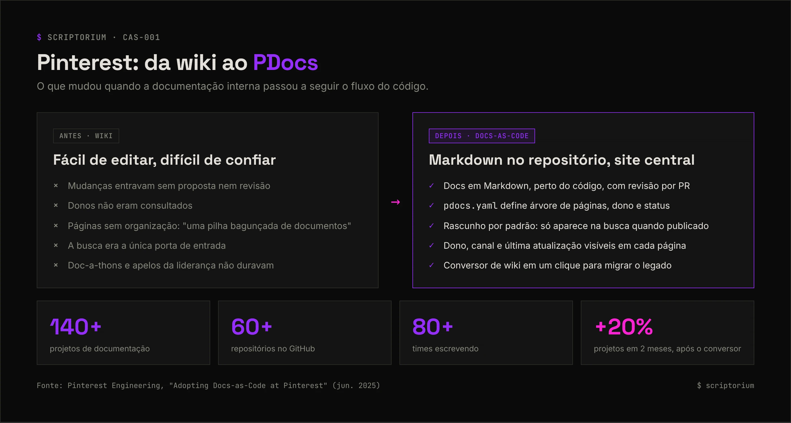

<picture>
  <source media="(prefers-color-scheme: light)" srcset="../_assets/banners/banner-casos-claro.webp">
  
</picture>

# CAS-001 · Pinterest e a adoção de docs-as-code

| Campo | Valor |
|---|---|
| Código | `CAS-001` |
| Tipo | Registro de caso |
| Status | Publicado |
| Organização | Pinterest — time Internal Tools Platform |
| Fonte | Relato da própria empresa (blog de engenharia) |
| Criado em | 15/10/2026 |
| Última atualização | 15/10/2026 · [histórico](https://github.com/SamaraSilvia81/scriptorium/commits/main/04-casos/CAS-001-pinterest-docs-as-code.md) |
| Relacionados | [`NOT-003`](../02-docs-as-code/NOT-003-o-que-e-docs-as-code.md) · [`NOT-001`](../01-fundamentos/NOT-001-por-que-documentar.md) |

> **Em uma frase:** depois que eventos e apelos da liderança não melhoraram a documentação interna, o Pinterest trocou a wiki por docs-as-code com uma ferramenta própria — e a adoção cresceu quando ficou fácil migrar o conteúdo antigo.

## Sumário

1. [Contexto](#1-contexto)
2. [O problema](#2-o-problema)
3. [A abordagem](#3-a-abordagem)
4. [Antes e depois](#4-antes-e-depois)
5. [Resultados relatados](#5-resultados-relatados)
6. [O que podemos aprender](#6-o-que-podemos-aprender)
7. [Limitações do relato](#7-limitações-do-relato)
8. [Próximos passos citados pelo Pinterest](#8-próximos-passos-citados-pelo-pinterest)
9. [Fontes](#9-fontes)

## 1. Contexto

Em junho de 2025, Jacob Seiler, Jay Kim e Charlie Gu, do time Internal Tools Platform do Pinterest, publicaram no blog de engenharia da empresa um relato sobre a mudança na forma de escrever e manter a documentação interna. O caso também foi noticiado pela InfoQ.

## 2. O problema

Segundo o relato, pesquisas internas com pessoas desenvolvedoras apontavam a documentação como **um dos principais pontos de dor**, especialmente em qualidade e facilidade de encontrar as informações.

A empresa já tinha tentado resolver de outras formas: ferramentas de wiki, *doc-a-thons* e apelos da liderança. Nenhuma produziu melhoria duradoura.

Os problemas da wiki, nas palavras do relato:

- **Editar era fácil, mas não havia como propor mudanças** nem coletar feedback antes de publicar.
- **Donos não eram consultados.** Documentos eram alterados sem que os responsáveis soubessem.
- **Faltava organização.** A wiki virou "uma pilha bagunçada de documentos, em vez de uma coleção de árvores bem organizadas".
- **A busca era a principal porta de entrada**, já que a navegação não ajudava.

## 3. A abordagem

O Pinterest adotou docs-as-code — Markdown no controle de versão, muitas vezes ao lado do código, validado por CI/CD e publicado por um gerador de site — e construiu ferramentas internas para tornar isso viável em escala.

| Componente | O que faz |
|---|---|
| **PDocs** | Site central de documentação. Percorre vários repositórios, encontra os projetos de documentação e os renderiza num só lugar. Feito com Next.js |
| **`pdocs.yaml`** | Arquivo de configuração por projeto, inspirado no MkDocs. Define a árvore de páginas e metadados como dono e status de publicação |
| **Rascunho por padrão** | Projetos novos começam como rascunho: não aparecem na página inicial nem na busca até serem publicados |
| **CLI** | Cria projetos novos com configuração e templates básicos |
| **Servidor local** | Pré-visualização com recarregamento automático enquanto se escreve |
| **Busca** | Indexada na busca interna, filtrada por projeto. Rascunhos ficam de fora |
| **Metadados na página** | Dono, canal do Slack, última atualização (vinda do GitHub), árvore de navegação, sumário e link "editar" |
| **Conversor de wiki** | Migração de uma página da wiki para Markdown em um clique |
| **Integrações com IA** | Chat dentro do PDocs e um bot no chat interno, alimentados pela documentação em Markdown |

## 4. Antes e depois

<picture>
  <source media="(prefers-color-scheme: light)" srcset="../_assets/diagramas/pinterest-antes-depois-claro.webp">
  
</picture>

## 5. Resultados relatados

| Indicador | Valor relatado |
|---|---|
| Projetos de documentação | Mais de 140 |
| Repositórios no GitHub com projetos | Mais de 60 |
| Times escrevendo | Mais de 80 |
| Crescimento após o conversor de wiki | +20% de projetos em dois meses |
| Uso | Um dos sites internos mais visitados do Pinterest |
| Satisfação | Pesquisas internas e feedback qualitativo indicam melhora |

A adoção começou **de boca em boca** e só foi anunciada para a empresa toda no início de 2022.

## 6. O que podemos aprender

- **Ferramenta ruim produz documentação ruim.** A conclusão do próprio relato é que ferramentas inadequadas contribuíam para a documentação ruim. A barreira não era só cultural.
- **Facilitar a migração destrava a adoção.** O salto de 20% veio depois do conversor de wiki. Ninguém quer reescrever à mão o que já existe.
- **Dono visível gera responsabilidade.** Mostrar quem é responsável e quando foi a última atualização em cada página ataca diretamente o problema de "ninguém sabe se isso ainda vale".
- **Rascunho por padrão protege a confiança.** Só entra na busca o que alguém decidiu publicar.
- **Começar pequeno funciona.** A adoção cresceu orgânica antes do anúncio oficial.

## 7. Limitações do relato

- É um **relato da própria empresa**, não um estudo independente.
- Os números medem **quantidade de projetos e uso**, não qualidade da documentação nem efeitos como tempo de onboarding.
- Os próprios autores reconhecem que **comparar a qualidade** com a wiki é difícil: o PDocs recebe principalmente projetos novos, enquanto o conteúdo antigo da wiki acumulou problemas ao longo do tempo.
- O Pinterest tinha estrutura para construir ferramentas internas. Times menores provavelmente usariam algo pronto (→ [ferramentas em `NOT-003`](../02-docs-as-code/NOT-003-o-que-e-docs-as-code.md#6-ferramentas)).

## 8. Próximos passos citados pelo Pinterest

- Conversores para outras plataformas, como Google Docs.
- Editor de Markdown dentro do PDocs que cria a pull request automaticamente — para quem não usa Git.
- Painel de saúde da documentação para os donos.
- Comentários e interação entre quem lê e quem escreve.

## 9. Fontes

- SEILER, Jacob; KIM, Jay; GU, Charlie. [Adopting Docs-as-Code at Pinterest](https://medium.com/pinterest-engineering/adopting-docs-as-code-at-pinterest-4f18ad169c25). Pinterest Engineering Blog, 3 jun. 2025. Acesso em: 15 out. 2026.
- DE SIMONE, Sergio. [How Docs-as-Code Helped Pinterest Improve Documentation Quality](https://www.infoq.com/news/2025/06/docs-as-code-at-pinterest). InfoQ, 16 jun. 2025. Acesso em: 15 out. 2026.

<picture>
  <source media="(prefers-color-scheme: light)" srcset="../_assets/banners/banner-rodape-claro.webp">
  
</picture>
