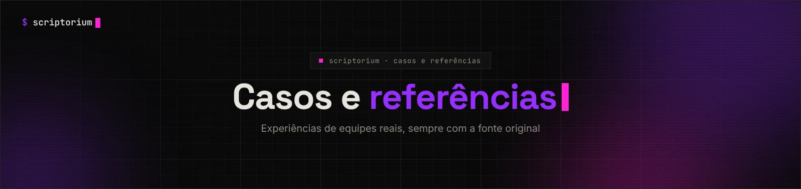

<picture>
  <source media="(prefers-color-scheme: light)" srcset="../_assets/banners/banner-casos-claro.webp">
  
</picture>

# 04 · Casos

Experiências públicas de organizações com documentação técnica. Cada caso registra o que a fonte diz — incluindo as limitações — e traz o link original.

| Código | Organização | Tema | Fonte | Status |
|---|---|---|---|---|
| [`CAS-001`](CAS-001-pinterest-docs-as-code.md) | Pinterest | Migração de wiki para docs-as-code | Blog de engenharia (2025) | Publicado |

<picture>
  <source media="(prefers-color-scheme: light)" srcset="../_assets/banners/banner-rodape-claro.webp">
  
</picture>
