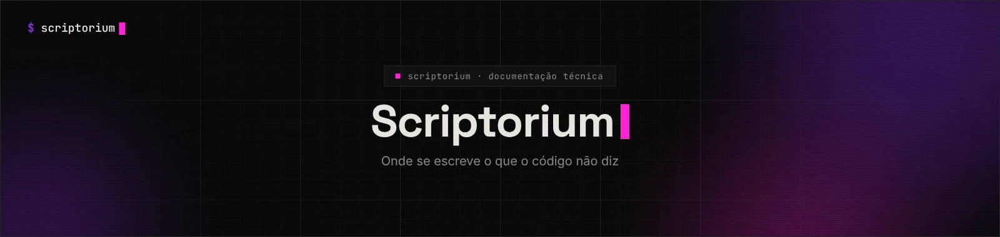
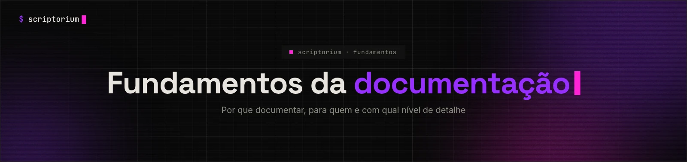
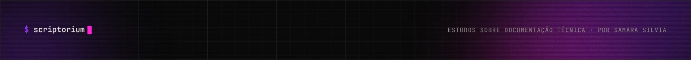

<picture>
  <source media="(prefers-color-scheme: light)" srcset="../_assets/banners/banner-topo-claro.webp">
  
</picture>

# MOD-001 · Modelo de nota de estudo

Use para textos que estudam um conceito, uma prática ou uma ferramenta. Copie o bloco abaixo para um arquivo novo `NOT-NNN-descricao.md` na pasta do tema e siga o [padrão do acervo](../PADRAO.md). Troque o banner pelo da seção (`banner-fundamentos`, `banner-docs-as-code`...).

````markdown
<picture>
  <source media="(prefers-color-scheme: light)" srcset="../_assets/banners/banner-fundamentos-claro.webp">
  
</picture>

# NOT-NNN · Título da nota

| Campo | Valor |
|---|---|
| Código | `NOT-NNN` |
| Tipo | Nota de estudo |
| Status | Rascunho |
| Criado em | DD/MM/AAAA |
| Última atualização | DD/MM/AAAA · [histórico](link) |
| Relacionados | `NOT-...` · `CAS-...` |

> **Pergunta principal:** qual pergunta este texto tenta responder?

## Sumário

1. [O problema](#1-o-problema)
2. [O conceito](#2-o-conceito)
3. [Na prática](#3-na-prática)
4. [Limitações](#4-limitações)
5. [Questões em aberto](#5-questões-em-aberto)
6. [Referências](#6-referências)

## 1. O problema

Uma cena ou situação concreta que mostra por que o assunto importa.
Prefira um exemplo que a pessoa reconheça a uma definição abstrata.

## 2. O conceito

O que é, quem propôs, de onde vem. Separe o que a fonte diz do que você interpreta.
Use tabela quando houver comparação; use diagrama quando houver fluxo ou eixos.

## 3. Na prática

Um exemplo aplicado: como o conceito aparece num projeto real ou hipotético.

## 4. Limitações

Onde a ideia não funciona tão bem. Todo conceito tem contexto.

## 5. Questões em aberto

O que ainda não está respondido — bom material para a próxima nota.

## 6. Referências

- SOBRENOME, Nome. [Título](URL). Veículo, ano.
````

## Checklist antes de publicar

- [ ] A pergunta principal está respondida no texto
- [ ] Toda afirmação de fato tem fonte nas referências
- [ ] Opiniões estão identificadas como opiniões
- [ ] Nenhum material de trabalho, de cliente ou confidencial (ver [padrão](../PADRAO.md#7-o-que-não-entra))
- [ ] Links internos e âncoras do sumário funcionam
- [ ] A linha da nota foi adicionada à tabela de documentos do [README](../README.md#-documentos)

<picture>
  <source media="(prefers-color-scheme: light)" srcset="../_assets/banners/banner-rodape-claro.webp">
  
</picture>
